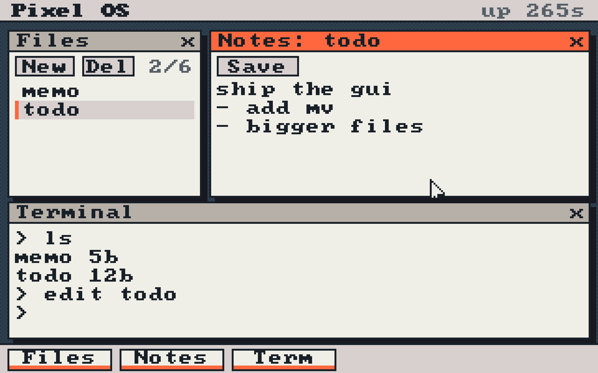

# Pixel OS

A small desktop operating system written in Rust. It boots on bare x86_64, draws its own windows on a 320x200 screen, and saves your files to disk.



Pixel OS is a learning project. It has no userspace and no standard library, just a kernel that talks to the hardware directly: VGA, the PS/2 keyboard and mouse, and an IDE disk.

## What you get

- **Files** lists what is on disk. Click a file to open it. New creates a note, Del removes the selected file.
- **Notes** is a text editor. The title shows an asterisk while there are unsaved changes. Save writes to disk.
- **Terminal** runs a handful of commands against the same disk (see below).
- **Windows** drag by the title bar, close with the x, and come back from the dock.

Everything you save survives a reboot.

## Run it

You need a Mac or Linux machine with [Rust](https://rustup.rs) and [QEMU](https://www.qemu.org).

```sh
brew install qemu            # or: apt install qemu-system-x86
cargo install bootimage
dd if=/dev/zero of=disk.img bs=1024 count=1024   # one-time, the persistent disk
cargo run
```

`rust-toolchain.toml` pins the nightly compiler and the components the build needs, so `rustup` installs them on the first build.

`cargo run` starts QEMU with two drives: the kernel image, and `disk.img` as a second IDE disk. Delete `disk.img` and recreate it to wipe your files. If the disk is missing, the desktop still runs but saving is off and the Files window says "No disk".

## Terminal commands

| Command | What it does |
|---|---|
| `help` | List commands |
| `ls` | List files with sizes |
| `cat F` | Print a file |
| `write F text` | Create or overwrite a file with `text` |
| `edit F` | Open a file in Notes, creating it if it does not exist |
| `rm F` | Delete a file |
| `echo text` | Print `text` |
| `clear` | Clear the screen |
| `about` | Version info |
| `up` | Seconds since boot |

Keystrokes go to the window on top. Click a window to focus it.

## Limits

These are deliberate, to keep the code small. Each is a constant or a short function you can change.

- 6 files, 512 bytes each, no folders.
- File names are 1 to 11 printable characters. There is no rename; use `write` and `rm`.
- The notes editor has no cursor movement. It appends and backspaces only.
- Input is polled, not interrupt driven. There are no arrow keys or function keys.
- The screen is 320x200 with 9 colors.

## How it works

| File | Job |
|---|---|
| `src/main.rs` | Entry point, main loop, panic handler (the screen turns solid orange) |
| `src/gfx.rs` | VGA mode 13h, palette, back buffer, 8x8 text. Copies to the screen once per frame at vblank |
| `src/input.rs` | PS/2 mouse and keyboard, plus the port I/O helpers |
| `src/fs.rs` | ATA PIO driver and the flat filesystem |
| `src/term.rs` | Terminal scrollback and command parser |
| `src/gui.rs` | Window manager, Files and Notes, dock, cursor |

The bootloader is the [`bootloader`](https://crates.io/crates/bootloader) 0.9 crate with its `vga_320x200` feature, which switches the display into mode 13h before the kernel starts. The font comes from [`font8x8`](https://crates.io/crates/font8x8).

**Filesystem layout.** The second disk is one flat table. Sector 0 holds 6 directory entries of 16 bytes each (name, length, used flag). Sector `1 + n` holds the contents of file `n`. A zeroed disk is a valid empty filesystem, so there is no format step.

## Design

One accent, no gradients, no rounded corners.

| Role | Hex |
|---|---|
| Ink (text, borders) | `#1b1f27` |
| Desktop (two-tone dither) | `#2b3a44`, `#31424d` |
| Paper (window body) | `#eeece6` |
| Panel (menubar, dock, buttons) | `#d5d3cc` |
| Inactive title | `#b4b2ab` |
| Muted text | `#566069` |
| Accent (active title, caret, selection) | `#ff6a3d` |

Shadows are hard offsets in a darker tint of the desktop. Muted text clears 4.5:1 contrast on paper.

## Roadmap

- Rename and move files
- Larger files and more of them
- Interrupt-driven input
- A higher-resolution framebuffer
- A heap, so windows can be created at runtime

## Development

```sh
cargo bootimage          # build only, image lands in target/x86_64-pixel_os/debug/
cargo run                # build and boot in QEMU
```

- **Add a terminal command:** add a match arm in `Term::run` in `src/term.rs`. Return `Some(name)` to open a file in Notes.
- **Add a window:** add a `Win` and an index constant in `src/gui.rs`, then a draw method and a `click` arm. The `z` array and dock are sized to 3, so bump those too.
- **Inspect the disk:** `hexdump -C disk.img | head`. Directory is the first 96 bytes, file `n` starts at byte `512 * (n + 1)`.
- **Headless test:** run QEMU with `-display none -monitor stdio`, then use `sendkey`, `mouse_move`, `mouse_button` and `screendump file.ppm` in the monitor.
- **Panics:** the screen turns solid orange. Graphics mode has no text output yet, so debug by bisecting.

## Developer

Built by **Ashutosh Swamy**.

- Portfolio: [ashutoshswamy.in](https://ashutoshswamy.in)
- GitHub: [ashutoshswamy](https://github.com/ashutoshswamy)
- LinkedIn: [ashutoshswamy](https://www.linkedin.com/in/ashutoshswamy)
- X: [@ashutoshswamy_](https://x.com/ashutoshswamy_)

## Troubleshooting

**`error: .json target specs require -Zjson-target-spec`**: use the repo's `.cargo/config.toml`; run `cargo` from the project root.

**QEMU says it cannot open `disk.img`**: create it with the `dd` command above.

**Keyboard does nothing**: click inside the QEMU window first so it captures input.
